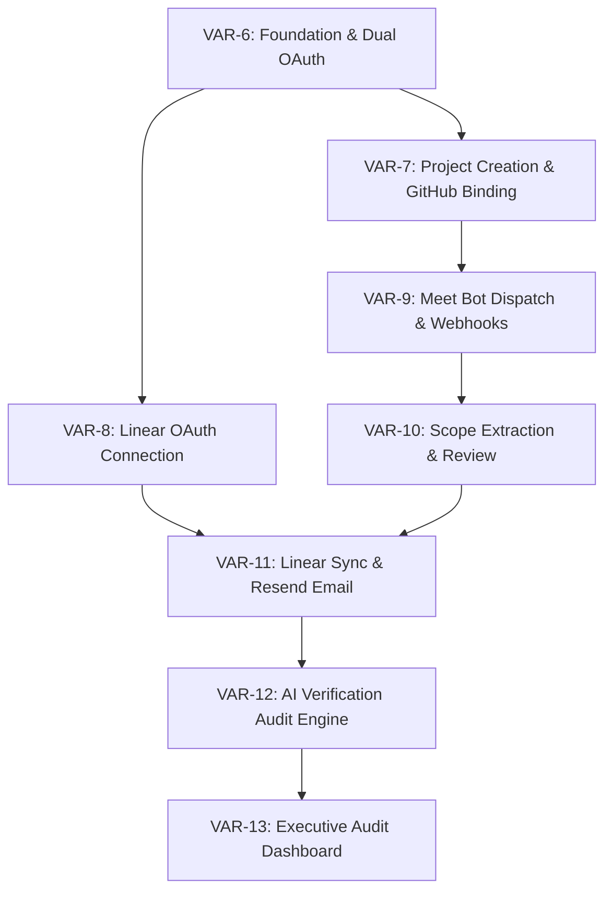

# CommitCheck Implementation Tickets

> **Parent Spec**: [VAR-5: Spec: CommitCheck - Meeting-to-Code Freelance Verification Platform](https://linear.app/varun-v-bhat/issue/VAR-5/spec-commitcheck-meeting-to-code-freelance-verification-platform)  
> **Linear Project**: [CommitCheck (P-VAR-1)](https://linear.app/varun-v-bhat/project/commitcheck-da3486290f78/overview)  
> **Triage Label**: `ready-for-agent`

---

## Dependency Graph

---

## Tickets Summary

| ID | Title | Blocked by | Linear Link | Status |
| :--- | :--- | :--- | :--- | :--- |
| **VAR-6** | **Ticket 1: Foundation Setup & Role-Enforced Dual OAuth** | *None (Frontier)* | [VAR-6](https://linear.app/varun-v-bhat/issue/VAR-6/ticket-1-foundation-setup-and-role-enforced-dual-oauth) | `ready-for-agent` |
| **VAR-7** | **Ticket 2: Project Creation & GitHub Repository Binding** | VAR-6 | [VAR-7](https://linear.app/varun-v-bhat/issue/VAR-7/ticket-2-project-creation-and-github-repository-binding) | `ready-for-agent` |
| **VAR-8** | **Ticket 3: Freelancer Linear OAuth & Workspace Connection** | VAR-6 | [VAR-8](https://linear.app/varun-v-bhat/issue/VAR-8/ticket-3-freelancer-linear-oauth-and-workspace-connection) | `ready-for-agent` |
| **VAR-9** | **Ticket 4: Google Meet Bot Dispatch & Webhook Ingestion (Recall.ai)** | VAR-7 | [VAR-9](https://linear.app/varun-v-bhat/issue/VAR-9/ticket-4-google-meet-bot-dispatch-and-webhook-ingestion-recallai) | `ready-for-agent` |
| **VAR-10** | **Ticket 5: AI Scope Extraction & Pre-Publish Review Staging** | VAR-9 | [VAR-10](https://linear.app/varun-v-bhat/issue/VAR-10/ticket-5-ai-scope-extraction-and-pre-publish-review-staging) | `ready-for-agent` |
| **VAR-11** | **Ticket 6: Linear Project Sync & Resend Stakeholder Notification** | VAR-8, VAR-10 | [VAR-11](https://linear.app/varun-v-bhat/issue/VAR-11/ticket-6-linear-project-sync-and-resend-stakeholder-notification) | `ready-for-agent` |
| **VAR-12** | **Ticket 7: Dual-Tier AI Verification & Audit Engine** | VAR-11 | [VAR-12](https://linear.app/varun-v-bhat/issue/VAR-12/ticket-7-dual-tier-ai-verification-and-audit-engine) | `ready-for-agent` |
| **VAR-13** | **Ticket 8: Executive Audit Dashboard & Clarification Loop** | VAR-12 | [VAR-13](https://linear.app/varun-v-bhat/issue/VAR-13/ticket-8-executive-audit-dashboard-and-clarification-loop) | `ready-for-agent` |

---

### Implementation Frontier
The current frontier ticket ready to be claimed immediately is:
👉 **[VAR-6: Ticket 1: Foundation Setup & Role-Enforced Dual OAuth](https://linear.app/varun-v-bhat/issue/VAR-6/ticket-1-foundation-setup-and-role-enforced-dual-oauth)**
