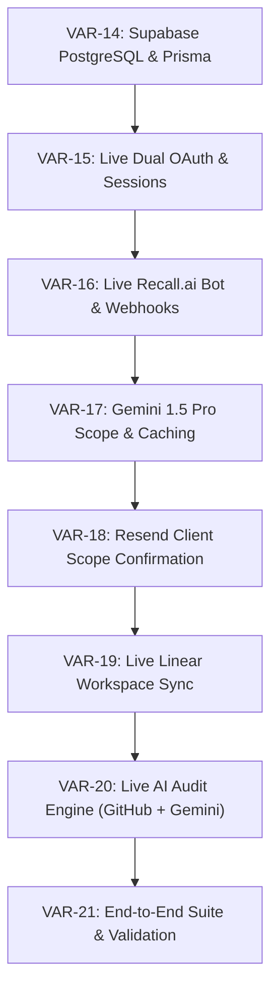

# CommitCheck Implementation Tickets

> **Parent Spec**: [VAR-5: Spec: CommitCheck - Meeting-to-Code Freelance Verification Platform](https://linear.app/varun-v-bhat/issue/VAR-5/spec-commitcheck-meeting-to-code-freelance-verification-platform)  
> **Linear Project**: [CommitCheck (P-VAR-1)](https://linear.app/varun-v-bhat/project/commitcheck-da3486290f78/overview)  
> **Triage Label**: `ready-for-agent`

---

## Dependency Graph: Phase 2 Live Backend

---

## Phase 2: Live Backend Tickets Summary

| ID | Title | Blocked by | Linear Link | Status |
| :--- | :--- | :--- | :--- | :--- |
| **VAR-14** | **Backend: Supabase PostgreSQL Migration & Live Prisma Persistence** | *None (Frontier)* | [VAR-14](https://linear.app/varun-v-bhat/issue/VAR-14/backend-supabase-postgresql-migration-and-live-prisma-persistence) | `ready-for-agent` |
| **VAR-15** | **Backend: Live Dual-Role OAuth & Session Management** | VAR-14 | [VAR-15](https://linear.app/varun-v-bhat/issue/VAR-15/backend-live-dual-role-oauth-and-session-management) | `ready-for-agent` |
| **VAR-16** | **Backend: Live Recall.ai Bot Dispatch & Webhook Pipeline** | VAR-15 | [VAR-16](https://linear.app/varun-v-bhat/issue/VAR-16/backend-live-recallai-bot-dispatch-and-webhook-pipeline) | `ready-for-agent` |
| **VAR-17** | **Backend: Live Gemini 1.5 Pro Single-Call Scope Classification & Caching** | VAR-16 | [VAR-17](https://linear.app/varun-v-bhat/issue/VAR-17/backend-live-gemini-15-pro-single-call-scope-classification-and) | `ready-for-agent` |
| **VAR-18** | **Backend: Resend Client Scope Confirmation Loop & Approval Portal** | VAR-17 | [VAR-18](https://linear.app/varun-v-bhat/issue/VAR-18/backend-resend-client-scope-confirmation-loop-and-approval-portal) | `ready-for-agent` |
| **VAR-19** | **Backend: Live Linear Workspace Sync & Project Publishing** | VAR-18 | [VAR-19](https://linear.app/varun-v-bhat/issue/VAR-19/backend-live-linear-workspace-sync-and-project-publishing) | `ready-for-agent` |
| **VAR-20** | **Backend: Live Dual-Tier AI Verification & Audit Engine (GitHub + Gemini)** | VAR-19 | [VAR-20](https://linear.app/varun-v-bhat/issue/VAR-20/backend-live-dual-tier-ai-verification-and-audit-engine-github-gemini) | `ready-for-agent` |
| **VAR-21** | **Backend: End-to-End Integration Suite & Environment Validation** | VAR-20 | [VAR-21](https://linear.app/varun-v-bhat/issue/VAR-21/backend-end-to-end-integration-suite-and-environment-validation) | `ready-for-agent` |

---

## Phase 1: Completed Foundation & Prototype Tickets

| ID | Title | Status |
| :--- | :--- | :--- |
| **VAR-6** | Ticket 1: Foundation Setup & Role-Enforced Dual OAuth | `Done` |
| **VAR-7** | Ticket 2: Project Creation & GitHub Repository Binding | `Done` |
| **VAR-8** | Ticket 3: Freelancer Linear OAuth & Workspace Connection | `Done` |
| **VAR-9** | Ticket 4: Google Meet Bot Dispatch & Webhook Ingestion (Recall.ai) | `Done` |
| **VAR-10** | Ticket 5: AI Scope Extraction & Pre-Publish Review Staging | `Done` |
| **VAR-11** | Ticket 6: Linear Project Sync & Resend Stakeholder Notification | `Done` |
| **VAR-12** | Ticket 7: Dual-Tier AI Verification & Audit Engine | `Done` |
| **VAR-13** | Ticket 8: Executive Audit Dashboard & Clarification Loop | `Done` |

---

### Implementation Frontier
The current frontier ticket ready to be claimed immediately is:
👉 **[VAR-14: Backend: Supabase PostgreSQL Migration & Live Prisma Persistence](https://linear.app/varun-v-bhat/issue/VAR-14/backend-supabase-postgresql-migration-and-live-prisma-persistence)**
